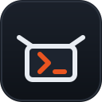

# devbox

A disposable, isolated Ubuntu development VM on macOS, powered by
[Colima](https://colima.run).

- **Your editor stays on the Mac; your code runs in the VM.** Editors and SSH
  clients live on macOS, while the project files, shells, compilers, CLIs, and
  project processes live inside the guest.
- **Isolated.** Nothing on the host is mounted into the guest. The managed
  PostgreSQL and Valkey containers run in the guest under root.
- **Disposable.** The VM is cheap to destroy and recreate; your code lives on
  the VM disk and is removed only by `devbox destroy`.
- **No host dependency sprawl.** Apart from Colima and the built-in OpenSSH
  client, nothing is installed on the Mac.

Design and internals are documented in
[docs/architecture.md](docs/architecture.md).

## Contents

- [Requirements](#requirements)
- [Install](#install)
- [Quick start](#quick-start)
- [What's in the VM](#whats-in-the-vm)
- [Daily commands](#daily-commands)
- [Editing guest files from the Mac](#editing-guest-files-from-the-mac)
- [Configuration](#configuration)
- [Services](#services)
- [Authentication](#authentication)
- [Maintenance](#maintenance)
- [Security](#security)
- [Documentation](#documentation)

## Requirements

| Requirement | Notes |
| --- | --- |
| macOS 13+ on Apple Silicon | Colima runs as a Linux VM |
| [Colima](https://colima.run) 0.10.3 or newer | the VM engine |
| OpenSSH client | built into macOS |

Nothing else: no Homebrew, `jq`, `yq`, Docker, or Docker Compose on the host.

## Install

```sh
curl -fsSL https://github.com/koraybostanci/devbox/releases/latest/download/install.sh | bash
```

The installer downloads the latest release, verifies its SHA-256 checksum, and
installs it under `~/.local/share/devbox/versions/<version>` with a `current`
symlink; `~/.local/bin/devbox` points at `current/devbox`. Nothing depends on a
clone, and no `sudo` is used. Your configuration lives in
`~/.config/devbox/env`, outside the install, so upgrades never touch it. If a
clone-based install exists, its `.env` is copied there once.

`devbox update` installs the latest release (or `--version X.Y.Z`, which also
rolls back); the two newest versions are kept. `devbox uninstall` removes the
install but keeps the configuration and the VM. Then run `devbox init`.

To work from a clone instead (development), use `./devbox init` below.

## Quick start

```sh
devbox init            # answer the prompts (from a clone: ./devbox init)
# If init prints a PATH instruction, follow it or keep using ./devbox.
devbox start           # create and provision the VM
devbox connect         # open a zsh shell in the guest
devbox status          # see the VM's state and resources
devbox stop
```

From a clone, `devbox init` asks for your settings and installs a `devbox`
symlink into `~/.local/bin` (a release install already has one). If that
directory is not on your `PATH`, add `export PATH="$HOME/.local/bin:$PATH"` to your shell configuration and open a
new shell. Until then, use `./devbox` from the checkout. `devbox uninstall`
removes the symlink.

### Editing guest files from the Mac

Your code lives in the guest at `/home/devbox/workspace`. To work on it from
editors, `git`, and other tools on the Mac, connect over SSH once:

1. Add `Include ~/.ssh/devbox.conf` at the **top** of `~/.ssh/config`.
2. Point your tools at host `devbox` (the alias in that file).

`devbox start` and `devbox provision` keep the managed file updated with the
VM's current SSH endpoint; `devbox destroy` removes the file, and the
`Include` line can stay where it is.

## What's in the VM

Provisioning installs everything below; the guest shell is zsh with
oh-my-zsh:

| Group | Contents |
| --- | --- |
| Languages | Node.js and npm (nvm), Python (pyenv) with uv, Go, Rust, Java 25 |
| Agent CLIs | Claude Code, OpenCode, Databricks CLI |
| Tools | `gh`, `jq`, `yq`, Vim, a per-user rootless Docker daemon, native ARM64 Chromium |

[`provision/versions.env`](provision/versions.env) is the source of truth for
the pinned versions. `gh`, `jq`, and snapd come from Ubuntu packages; the
rootless Docker prerequisites (`docker-ce-rootless-extras`) come from
Colima's Docker APT source, not Ubuntu's.

Use `vim <file>` to edit files in the guest terminal; `$EDITOR` and `$VISUAL`
are set to `vim` by default.

## Daily commands

| Command | What it does |
| --- | --- |
| `devbox start` | start and converge the VM |
| `devbox connect` | open a zsh shell in the guest |
| `devbox exec <command>` | run a single command in the guest |
| `devbox status` | VM state and resources |
| `devbox version` | the devbox version |
| `devbox update [--version X.Y.Z]` | update a release install |
| `devbox help` | the full command list |
| `devbox stop [--force]` | stop the VM; force only when requested |

Your code lives on the guest disk at `/home/devbox/workspace`; it survives
stop/start and is removed only by `devbox destroy`.

## Configuration

`devbox init` asks for the settings and writes `.env` in the checkout, or
`~/.config/devbox/env` for a release install (mode 0600, gitignored in the
checkout). Prompts default to the current value, the host Git
identity, or the built-in value in brackets. Rerun `devbox init` to change
them.

A written file looks like:

```sh
export GIT_NAME="Your Name"
export GIT_EMAIL="you@personal.com"
export POSTGRES_USER="dev"
export POSTGRES_DB="dev"
export POSTGRES_PORT="15432"
export DEVBOX_CPU="4"
export DEVBOX_MEMORY="4"
export DEVBOX_DISK="60"
export DEVBOX_USE_HOST_PROXY="false"
```

| Setting | Default | Notes |
| --- | --- | --- |
| `GIT_NAME`, `GIT_EMAIL` | host Git identity | seeded into the guest and re-applied by each provisioning run |
| `POSTGRES_USER`, `POSTGRES_DB`, `POSTGRES_PORT` | `dev`, `dev`, `15432` | service settings; the PostgreSQL password is a guest-generated secret |
| `DEVBOX_CPU`, `DEVBOX_MEMORY`, `DEVBOX_DISK` | `4`, `4`, `60` | size the VM; changing them requires recreating it |
| `DEVBOX_USE_HOST_PROXY` | `false` | export host proxy variables into the guest |

Notes:

- The identity and PostgreSQL keys are seeded into the guest on first
  provision and maintained in the guest at `~/.config/devbox/config`
  afterwards. The key set and the value rules (supported names, quote
  handling, PostgreSQL user/db and port limits) are pinned in
  [docs/troubleshooting.md](docs/troubleshooting.md).
- To keep the configuration somewhere other than the default (the checkout's `.env`, or `~/.config/devbox/env` for a release) — for
  example a dotfiles symlink — run any devbox command with
  `DEVBOX_ENV_FILE=/path/to/env` in the environment (that is a process
  variable, not a key inside `.env`).
- By default, host proxy variables are cleared from Colima. With
  `DEVBOX_USE_HOST_PROXY="true"`, the proxy URLs — including any embedded
  credentials — persist on the VM disk. Proxy changes apply at the next VM
  start: run `devbox stop`, then `devbox start`. See
  [docs/troubleshooting.md](docs/troubleshooting.md) and
  [docs/architecture.md](docs/architecture.md#host--guest-boundary) for the
  mechanism.
- Service secrets are generated in the guest and are not placed in the host
  `.env` or repository. They persist on the VM disk, which is stored on the
  host under Colima storage.

## Services

PostgreSQL and Valkey are staged root-managed in the guest but stay stopped
until you start them:

```sh
devbox services start
devbox services status
devbox services stop
```

The service contract — the rootful Docker socket, loopback-only bindings,
credential locations, and data paths — is in
[docs/architecture.md](docs/architecture.md#services).

### Rootless Docker and Chromium

Direct `docker` commands in the guest run against a separate Docker daemon
owned by `devbox` at `unix:///run/user/<uid>/docker.sock` (the `rootless`
Docker context); this does not replace or upgrade Colima's rootful Engine,
which remains reserved for `devbox services`. For Puppeteer, the guest's
managed `.zshenv` points `PUPPETEER_EXECUTABLE_PATH` at
`/snap/bin/chromium`, and a project can override it. The full policy is in
[docs/architecture.md](docs/architecture.md#rootless-docker-and-chromium).

## Authentication (optional)

Provider sign-in is optional and happens inside the guest; host provider CLI
credentials are not imported.

| Command | What it does |
| --- | --- |
| `devbox auth status` | show github, claude, opencode, databricks state |
| `devbox auth login github` | start `gh auth login` inside the guest |
| `devbox auth login opencode` | start `opencode auth login` in the guest |
| `devbox auth login claude` | print the steps to finish Claude login |
| `devbox auth login databricks` | print the databricks login command |
| `devbox db info` | show PostgreSQL connection settings |

`claude` and `databricks` cannot be scripted from the companion, so those
commands print the next step instead of starting a login.

Credentials are written inside the guest and survive stop/start; they are
removed only by `devbox destroy`.

## Maintenance

| Command | What it does |
| --- | --- |
| `devbox provision` | force non-destructive provisioning |
| `devbox destroy` | remove the VM and its container runtime data |
| `devbox update [--version X.Y.Z]` | update (or roll back) a release install |
| `devbox uninstall` | remove the devbox symlink; for a release install, also the installed versions (config and VM are kept) |

## Security

- There are no host filesystem mounts, and the host SSH agent is not
  forwarded. (Agent host-boundary instructions are policy, not network
  enforcement.)
- The guest keeps ordinary network access, including to the host gateway.
  No host filesystem mount does not mean host-network isolation.
- The VM disk — workspace, credentials, and service secrets — lives on the
  host under Colima storage; host disk permissions, encryption, and backups
  are part of the boundary.
- Direct SSH is keyed, not staged: every `devbox start` and `devbox
  provision` wholesale-replaces the guest's
  `/home/devbox/.ssh/authorized_keys` with the host key, removing
  user-added guest keys by design. The replacement stays fail-closed — a
  failed provisioning run removes the managed alias rather than leaving
  partial access.
- Provisioning is checksum-verified inside the guest.

The full boundary is in
[docs/architecture.md](docs/architecture.md#host--guest-boundary).

## Documentation

| Document | Contents |
| --- | --- |
| [docs/architecture.md](docs/architecture.md) | design and internals: boundary, identity, provisioning, services, lifecycle |
| [docs/troubleshooting.md](docs/troubleshooting.md) | key set and value rules, common failures, upgrades |
| [docs/smoke-test.md](docs/smoke-test.md) | manual end-to-end test on a real Mac |
