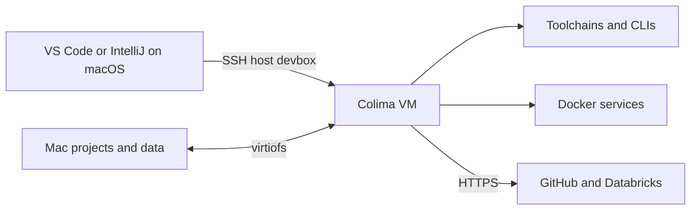

# devbox

**A disposable Linux workstation that feels local.**

Keep your editors and project files on macOS. Run shells, compilers, CLIs, credentials, Docker, and project processes inside an isolated Ubuntu VM powered by Colima.

[Quick start](#quick-start) | [Daily workflow](#daily-workflow) | [IDEs](#ides) | [Authentication](#authentication) | [Persistence](#persistence) | [Command reference](#command-reference)

## At a Glance

| Concern | Where it lives |
|---|---|
| Editors | macOS |
| Projects and durable data | Mac-backed virtiofs mounts |
| Toolchains and processes | Ubuntu 24.04 guest |
| GitHub and Databricks credentials | Guest-local stores |
| Containers and volumes | Docker inside the guest |
| IDE transport | Managed OpenSSH host `devbox` |



The host Docker context stays untouched. Host SSH agents and private keys never enter the VM. Rebuild the guest whenever you like; your projects remain on the Mac.

## Requirements

- Apple Silicon
- macOS 13 or newer
- Colima 0.10.3 or newer
- VZ, virtiofs, and Docker

Intel Macs, QEMU, Kubernetes, and alternate container runtimes are intentionally outside the supported path.

## Quick Start

### 1. Install Host Tools

```sh
brew install colima docker docker-compose jq yq
```

### 2. Clone and Initialize

```sh
git clone https://github.com/koraybostanci/devbox.git
cd devbox
./devbox init
```

The first `init` creates `.env` with mode `0600`. Fill in your Git identity, Anthropic key, optional Databricks host, local-service credentials, VM resources, and storage paths.

### 3. Validate and Start

```sh
./devbox init
./devbox install
devbox start
devbox github login
```

`init` validates rather than installing host packages. `install` adds a user-local symlink without `sudo`. GitHub authorization opens on macOS and stores the resulting credential only in the guest.

### 4. Check the Result

```sh
devbox doctor
devbox ide
```

When both pass, connect an editor or enter the guest with `devbox connect`.

> [!NOTE]
> Upgrading a profile from the old home-based mount layout? Run `devbox rebuild` once to move it to `/mnt/devbox/*`.

## Daily Workflow

The usual loop is deliberately short:

```sh
devbox start
devbox connect
# work
devbox stop
```

| I want to... | Command |
|---|---|
| Start or converge the environment | `devbox start` |
| Open a guest shell | `devbox connect` |
| Run one guest command | `devbox exec <command> [args...]` |
| Check VM resources | `devbox status` |
| Verify IDE connection details | `devbox ide` |
| Diagnose the full environment | `devbox doctor` |
| Apply `.env` credential changes | `devbox rotate` |
| Force provisioning without rebuilding | `devbox provision` |
| Stop gracefully | `devbox stop` |

`start` waits for SSH and mounts, refreshes the dynamic IDE connection, streams the allowlisted guest environment over stdin, and provisions only when repository inputs changed. It never opens a shell, browser, or authentication prompt.

## IDEs

Always run `devbox start` first. Both editors connect through the managed OpenSSH host named `devbox`.

### VS Code

1. Open **Remote - SSH**.
2. Select `devbox`.
3. Open `~/projects`.

### IntelliJ IDEA

1. Open JetBrains Gateway and create a new SSH configuration.
2. Set **Host** to `devbox`.
3. Select **OpenSSH config and authentication agent**.
4. Enable **Parse config file `~/.ssh/config`**.
5. Do not override the resolved port or identity.
6. Connect and open `~/projects`.

Colima assigns a new localhost port when the VM is recreated. The launcher refreshes a marked `Host devbox` block directly in `~/.ssh/config`, including the current port and dedicated key.

> [!IMPORTANT]
> Never save a guessed port such as `2222`. If Gateway shows `localhost`, an old port, or `agent` authentication after rebuild, delete that saved profile and create it again from `devbox`. Restart Gateway once if it cached the old config.

For verified manual fallback values, run:

```sh
devbox ide
```

## Authentication

IDE access and service authentication are separate. The IDE uses Colima's dedicated SSH key; cloud services use guest-local HTTPS/OAuth credentials.

### GitHub

```sh
devbox github login
devbox github status
devbox github logout
```

Login opens GitHub's device page in the macOS browser. Enter the one-time code printed in the terminal. A plaintext-storage warning is expected because the headless guest has no desktop keychain; the mode-`0600` credential file remains inside the VM.

Clone with HTTPS inside the guest:

```sh
gh repo clone owner/repository
git remote set-url origin https://github.com/owner/repository.git
```

### Databricks

Set `DATABRICKS_HOST` in `.env`, then manage the `DEFAULT` OAuth profile explicitly:

```sh
devbox databricks login
devbox databricks status
devbox databricks logout
```

> [!IMPORTANT]
> Authentication is intentionally outside provisioning. After `rebuild` or `destroy`, log in to GitHub and Databricks again. No GitHub or Databricks token belongs in `.env`.

## Persistence

Defaults can be overridden in `.env`.

| Data | Guest location | Stop/start | Rebuild | Destroy |
|---|---|---|---|---|
| Projects | `/mnt/devbox/projects` and `~/projects` | Preserved | Preserved | Preserved |
| General data | `/mnt/devbox/data` and `~/data` | Preserved | Preserved | Preserved |
| Docker named volumes | Guest Docker | Preserved | Preserved | Removed |
| Guest OS and tools | Guest filesystem | Preserved | Recreated | Removed |
| GitHub and Databricks login | Guest credential stores | Preserved | Re-authenticate | Removed |

Mac-backed projects and data live outside the VM lifecycle. Lima may use a home such as `/home/yourname.guest`; scripts always resolve `$HOME` instead of guessing it from the username.

## Containers

PostgreSQL 18.3 is included but never auto-started:

```sh
devbox containers postgres up
devbox containers postgres ps
devbox containers postgres logs
devbox containers postgres down
```

PostgreSQL binds only to `127.0.0.1:${POSTGRES_PORT}` and stores data in the `devbox-postgres-data` named volume. `devbox containers up` targets every bundled service. Use `pg_dump` when you need a portable backup.

## Lifecycle

| Command | Effect |
|---|---|
| `devbox stop` | Graceful shutdown; everything is preserved |
| `devbox stop --force` | Forced shutdown for recovery only |
| `devbox rebuild` | One confirmation, then unattended guest recreation; Mac data and Docker volumes survive |
| `devbox destroy` | Strong confirmation; VM and Docker runtime data are removed, Mac data survives |
| `devbox uninstall` | Removes only the CLI symlink owned by this checkout |

`devbox delete` deliberately deletes nothing and directs callers to `destroy`. A PID-checked lock prevents concurrent lifecycle mutations and safely recovers stale locks.

## Command Reference

| Command | Purpose |
|---|---|
| `devbox init` | Validate host prerequisites and initialize local configuration |
| `devbox install` | Install the user-local CLI symlink |
| `devbox start` | Start the VM and converge changed inputs |
| `devbox provision` | Force non-destructive provisioning |
| `devbox connect` | Open a guest zsh shell |
| `devbox exec <command>` | Run a command in the guest |
| `devbox status` | Show VM state and resources |
| `devbox ide` | Verify and print IDE SSH settings |
| `devbox rotate` | Apply `.env` credential changes without restarting |
| `devbox github ...` | Manage guest-local GitHub authentication |
| `devbox databricks ...` | Manage guest-local Databricks authentication |
| `devbox containers ...` | Manage bundled Docker services |
| `devbox doctor` | Run host and guest diagnostics |
| `devbox stop [--force]` | Stop the VM |
| `devbox rebuild` | Recreate guest OS and tools |
| `devbox destroy` | Remove VM and Docker runtime data |
| `devbox uninstall` | Remove the CLI symlink |

Run `devbox help` for subcommand details.

## Customize and Maintain

- VM resources and Mac-backed paths: edit `.env`.
- Guest tool versions: edit `provision/versions.env`.
- Repository-owned skills: add files under `provision/config/skills/`.
- Unattended remote skills: add validated `npx` commands to `provision/config/install-skills.txt`.
- Claude Code plugins: edit `provision/config/install-plugins.txt`.

Provisioning is idempotent and content-digest driven. Optional plugins and skills warn on failure without invalidating core readiness.

Validate repository changes with:

```sh
scripts/check.sh
```

For the details behind the pleasant path, see [architecture](docs/architecture.md), [troubleshooting](docs/troubleshooting.md), and the [release checklist](docs/release-checklist.md).
