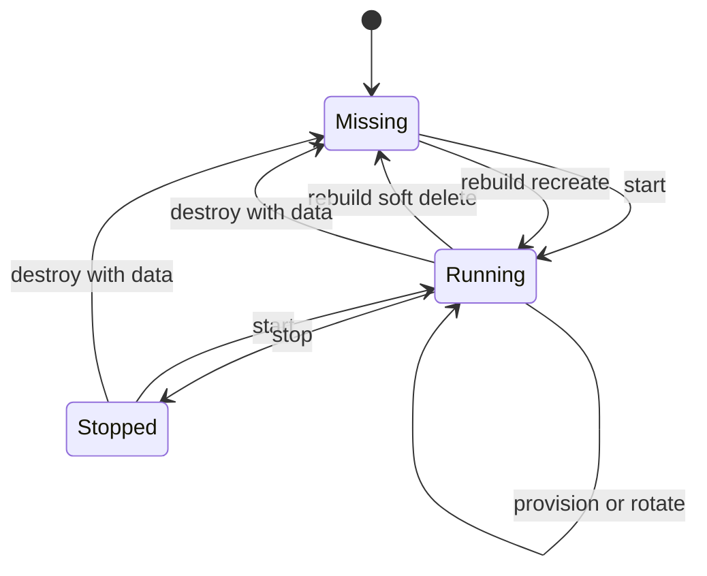

# Architecture

## Trust Boundary

The host owns only the repository, `.env`, Mac-backed project/data directories, the named Colima profile, an isolated Docker configuration root, a user-local CLI symlink, and one marked OpenSSH host block. Development tools and processes run in the guest.

```mermaid
flowchart LR
    IDE[VS Code or IntelliJ] -->|OpenSSH Host devbox| VM[Colima VZ VM]
    CLI[devbox CLI] -->|Colima dedicated key| VM
    ENV[mode-0600 .env] -->|allowlist over stdin| GENV[guest mode-0600 env]
    PROJECTS[Mac projects] -->|virtiofs| PMOUNT[/mnt/devbox/projects]
    DATA[Mac data] -->|virtiofs| DMOUNT[/mnt/devbox/data]
    VM -->|HTTPS gh credentials| GH[GitHub]
    VM --> DOCKER[Guest Docker]
    DOCKER --> VOLUME[Named volumes]
```

## Host State

Every Colima invocation targets the named `devbox` profile in Colima's standard home. This keeps the VM visible to normal commands such as `colima list` while Colima's profile boundary isolates its disk, runtime, sockets, keys, and configuration from other VMs. Before reading, starting, rebuilding, or destroying an existing profile, the launcher requires an ownership marker bound to this checkout. Profiles created before the marker are adopted only when their Docker runtime and `/provision` mount identify this repository; unrelated profiles and other checkouts fail closed before configuration is changed.

The Docker CLI still receives `DOCKER_CONFIG=${XDG_CONFIG_HOME:-$HOME/.config}/devbox/docker` so plugin configuration remains independent from the host's normal Docker settings.

`COLIMA_HOME` may be unset or explicitly name the standard home. The former private home is accepted only when explicitly selected for the documented one-time migration workflow; other namespaces are rejected.

The generated Colima profile disables Docker auto-activation, automatic SSH config edits, and SSH-agent forwarding. Starting devbox therefore does not change the host's active Docker context or expose host signing capabilities.

## SSH

Colima generates the raw connection details and dedicated identity path. The launcher normalizes these into `Host devbox`, inserts `ForwardAgent no`, atomically writes `~/.ssh/config.d/devbox`, and mirrors that entry in a marked block in `~/.ssh/config`. The direct block supports IDE SSH parsers that do not follow `Include` directives and is refreshed whenever Colima changes the port. `destroy` removes both managed representations without touching unrelated SSH hosts.

This transport is only for host-to-guest IDE/CLI access. GitHub repository access uses `gh` over HTTPS inside the guest.

## Persistence

`/mnt/devbox/projects` and `/mnt/devbox/data` are virtiofs mounts from explicit host directories. Safe links expose them as `~/projects` and `~/data`; provisioning fails on collisions and never deletes existing user paths.

Docker data remains in the named Colima profile. A soft Colima delete used by `rebuild` preserves named volumes. `destroy --data` removes them. Mac-backed mounts are outside both operations.

## Provisioning

The host hashes `colima.yaml` and every file under `provision/`. `start` compares this digest with a guest marker and converges only when stale. `provision` forces the same pipeline:

1. Stream the allowlisted environment over stdin.
2. Run root package provisioning.
3. Run user runtime/application/configuration modules.
4. Run unattended optional add-ons; failures warn without invalidating core readiness.
5. Run readiness checks.
6. Atomically update the digest marker only after success.

Secrets never appear in Colima command arguments or `/etc/environment`. Shells source `~/.config/devbox/env` deliberately.

Skill installers are restricted to validated `npx` argv, require installer-level unattended flags, and use full-command SHA-256 sentinels. GitHub and Databricks authentication are guest-local and explicitly managed with `devbox github` and `devbox databricks`. GitHub device login opens the authorization page in the macOS browser; rebuild, provisioning, and credential rotation never wait for authentication.

## Lifecycle



A PID-bearing `mkdir` lock serializes mutating commands. Stale locks are removed only when their recorded process no longer exists.
