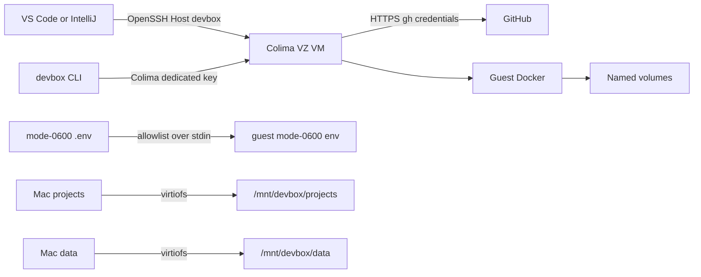
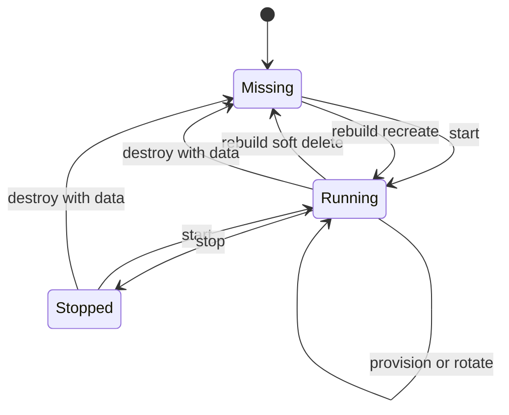

# Architecture

## Trust Boundary

The host owns only the repository, `.env`, Mac-backed project/data directories, the named Colima profile, an isolated Docker configuration root, a user-local CLI symlink, and separate marked OpenSSH host blocks for legacy `devbox` and v2 `devbox-v2`. Development tools and processes run in the guest.

## Host State

Every Colima invocation targets the named `devbox` profile in Colima's standard home. This keeps the VM visible to normal commands such as `colima list` while Colima's profile boundary isolates its disk, runtime, sockets, keys, and configuration from other VMs. Before reading, starting, rebuilding, or destroying an existing profile, the launcher requires an ownership marker bound to this checkout. Profiles created before the marker are adopted only when their Docker runtime and `/provision` mount identify this repository; unrelated profiles and other checkouts fail closed before configuration is changed.

The Docker CLI still receives `DOCKER_CONFIG=${XDG_CONFIG_HOME:-$HOME/.config}/devbox/docker` so plugin configuration remains independent from the host's normal Docker settings.

`COLIMA_HOME` may be unset or explicitly name the standard home. The former private home is accepted only when explicitly selected for the documented one-time migration workflow; other namespaces are rejected.

The generated Colima profile disables Docker auto-activation, automatic SSH config edits, and SSH-agent forwarding. Starting devbox therefore does not change the host's active Docker context or expose host signing capabilities.

## Experimental Isolation POC

The opt-in `devbox isolation-poc` command owns a separate
`devbox-isolation-poc` profile and does not interact with normal-profile
ownership, mounts, data, or SSH configuration. It renders only supported
Colima 0.10.3 bridged-network settings and no `mounts` key, then verifies the
resulting guest and generated Lima configuration. It rejects other Colima
versions because its literal `user-v2` topology check is specific to 0.10.3.
Its Lima state and Docker CLI configuration are both separate from normal
devbox state. See [the POC document](isolation-poc.md) for its required
operator-supplied DNS/deny targets and the current strict failure caused by
Colima's generated `user-v2` network.

## Experimental v2 no-mount profile

`devbox v2` owns a second standard-home Colima profile, `devbox-v2`, with its
own ownership schema, host state root, and guest state root. Its lifecycle uses
the normal profile's shared host lock so lifecycle and SSH-config changes cannot
race. Its VZ/Docker
template intentionally omits the `mounts` key, disables auto activation, host
SSH configuration, SSH-agent forwarding, and Colima port forwarding. It invokes
Colima with its own isolated v2 Docker configuration and does not use the normal
profile wrapper, mount wait, or Mac project/data paths.

The v2 bundle digest is computed from a sorted list of each `provision/` file
and its SHA-256 digest. On a stale digest, the launcher separately streams the
`provision/` tree as a tar archive over the profile's dedicated SSH transport;
the archive traversal is not sorted. The guest extracts to a temporary
directory, verifies the required stage scripts, writes the digest marker, and
atomically moves the `provision/` tree below `/var/lib/devbox-v2`. Root
provisioning creates and reconciles the separate unprivileged `devbox` user,
its zsh login shell, and the real `/home/devbox/workspace` directory. The
root-owned provisioning input is readable but not writable by `devbox`, which
runs the tools and verifier; its allowlisted environment is transferred to
`/home/devbox/.config/devbox-v2/env`.

No-mount v2 does not assert strict network isolation. Phase 1 showed that stock
Colima 0.10.3 retains a Lima `user-v2` network in the isolation POC. The v2
profile neither depends on nor resolves that finding.

## SSH

Colima generates the raw connection details and dedicated identity path. The launcher normalizes these into `Host devbox`, inserts `ForwardAgent no`, atomically writes `~/.ssh/config.d/devbox`, and mirrors that entry in a marked block in `~/.ssh/config`. The direct block supports IDE SSH parsers that do not follow `Include` directives and is refreshed whenever Colima changes the port. `destroy` removes both managed representations without touching unrelated SSH hosts.

This transport is only for host-to-guest IDE/CLI access. GitHub repository access uses `gh` over HTTPS inside the guest.

For v2, the generated Colima account remains an internal provisioning transport.
The dedicated host key remains authorized for that generated bootstrap/admin
account and is separately authorized for `devbox` in root-owned OpenSSH
authorized-keys files. A separate marked host entry exposes `Host devbox-v2`
with `User devbox`, `IdentitiesOnly yes`, and `ForwardAgent no`. This entry is
refreshed without changing the legacy `Host devbox` block.

## Persistence

`/mnt/devbox/projects` and `/mnt/devbox/data` are virtiofs mounts from explicit host directories. Safe links expose them as `~/projects` and `~/data`; provisioning fails on collisions and never deletes existing user paths.

Docker data remains in the named Colima profile. A soft Colima delete used by `rebuild` preserves named volumes. `destroy --data` removes them. Mac-backed mounts are outside both operations.

## Provisioning

The host hashes `colima.yaml` and every file under `provision/`. `start` compares this digest with a guest marker and converges only when stale. `provision` forces the same pipeline:

1. Stream the allowlisted environment over stdin.
2. Run root package provisioning.
3. Run user runtime/application/configuration modules.
4. Run unattended optional add-ons; failures warn without invalidating core readiness.
5. Run readiness checks.
6. Atomically update the digest marker only after success.

Secrets never appear in Colima command arguments or `/etc/environment`. Shells source `~/.config/devbox/env` deliberately.

Skill installers are restricted to validated `npx` argv, require installer-level unattended flags, and use full-command SHA-256 sentinels. GitHub and Databricks authentication are guest-local and explicitly managed with `devbox github` and `devbox databricks`. GitHub device login opens the authorization page in the macOS browser; rebuild, provisioning, and credential rotation never wait for authentication.

## Lifecycle

A PID-bearing `mkdir` lock serializes mutating commands. Stale locks are removed only when their recorded process no longer exists.
